# ETT-101 Simulator: Expected Results

What you should see in the simulator for every ready-made experiment: the block diagram, the wiring on the kit, the oscilloscope screen, and the figures the lab book expects next to what the simulator shows.

> [!IMPORTANT]
> **Preliminary (beta) version.** The simulator is still being tested and may not match the real kit 100%; when it differs, the real kit is the reference. It is free and non-commercial, made only to help students, and must not be sold or used to make money in any way. Not affiliated with Emona Instruments or UNI-T.

All images come from the simulator itself (v0.31.3). The kit image is the simulator window with the wiring and switch settings of the setup file; the scope image is the oscilloscope screen about 3 seconds after the signal starts. The block diagrams are drawn from each setup's actual wiring; they are not copies of the book's figures.

## Reference books

The course lab books are adapted from the Emona lab manual written for this kit:

**Barry Duncan, *Experiments in Modern Analog and Digital Telecommunications*, Emona Telecoms-Trainer 101 (ETT-101) Lab Manual, Volume 1, and *Further Experiments in Modern Analog and Digital Telecommunications*, Volume 2. Emona Instruments Pty Ltd, Sydney, Australia.**

- **Term 1:** Electrical Testing (6) lab manual, ELC414. Its Exp 1–7 (AM, DSBSC, AM demodulation, DSBSC demodulation, SSB, FM, FM demodulation) come from Emona Volume 1 Exp 4–10. Also included: Exp 7 Part C (inside the zero-crossing detector).
- **Term 2:** Electrical Testing (7) lab manual, ELC424. Its 13 experiments come from Emona Volume 1 Exp 11, 12, 13, 15, 16, 17, 18 and 19 (sampling, PCM encoding and decoding, ASK, FSK, BPSK, QPSK, DSSS) and Volume 2 Exp 6, 8, 9, 16 and 17 (PWM, PLL carrier acquisition, signal-to-noise ratio, delta and delta-sigma).
- **Extra:** Emona Volume 1 Exp 3 from the Emona 101 Trainer SAMPLE Lab Manual, and Volume 1 Exp 14, Volume 1 Exp 20 and Volume 2 Exp 18 adapted from the Emona DATEx Lab Manual, Vol. 1 (with the VCO in place of the NI ELVIS function generator).

Under each experiment, the page and figure numbers are those printed in the course book, followed by the matching Emona experiment. The books themselves are not included in this repository.

## How to reproduce

Open the simulator, click **Load experiment** and pick it from the Term 1, Term 2 or Extra tab (or use **Open setup…** with the setup file named under the experiment), and wait a few seconds for the signals to settle. "Correlation" compares the shape of a signal with the original message: 1.000 means the same shape, and a negative value means it is inverted.

## Term 1 — Electrical Testing (6), ELC414

- [Exp 1 · AM Modulation — generating AM with a simple message](#exp-1--am-modulation--generating-am-with-a-simple-message)
- [Exp 2 · DSBSC Modulation — generating DSBSC with a simple message](#exp-2--dsbsc-modulation--generating-dsbsc-with-a-simple-message)
- [Exp 3 · AM Demodulation — recovering the message with an envelope detector](#exp-3--am-demodulation--recovering-the-message-with-an-envelope-detector)
- [Exp 4 · DSBSC Demodulation — recovering the message with a product detector](#exp-4--dsbsc-demodulation--recovering-the-message-with-a-product-detector)
- [Exp 4 · Part C — effect of message amplitude on the output (BUFFER)](#exp-4--part-c--effect-of-message-amplitude-on-the-output-buffer)
- [Exp 4 · VCO carrier — the VCO as the receiver's local carrier](#exp-4--vco-carrier--the-vco-as-the-receivers-local-carrier)
- [Exp 5 · SSB Modulation — generating SSB by the phasing method](#exp-5--ssb-modulation--generating-ssb-by-the-phasing-method)
- [Exp 5 · SSB Demodulation — recovering the message with a product detector](#exp-5--ssb-demodulation--recovering-the-message-with-a-product-detector)
- [Exp 6 · FM Modulation — FM with a square-wave message](#exp-6--fm-modulation--fm-with-a-square-wave-message)
- [Exp 6 · Part C — FM with a sine message](#exp-6--part-c--fm-with-a-sine-message)
- [Exp 7 · FM Demodulation — the zero-crossing detector](#exp-7--fm-demodulation--the-zero-crossing-detector)
- [Exp 7 · Part C — inside the zero-crossing detector](#exp-7--part-c--inside-the-zero-crossing-detector)
- [Exp 7 · Part D — sending and recovering a sine by FM](#exp-7--part-d--sending-and-recovering-a-sine-by-fm)

### Exp 1 · AM Modulation — generating AM with a simple message

*Electrical Testing (6) lab manual, ELC414 (Term 1) · p. 5 · Figs. 3–5 · adapted from Emona Vol. 1 Exp 4*

Setup file: [`setups/Term1/01-Exp1-AM-Modulation.ett.json`](../../setups/Term1/01-Exp1-AM-Modulation.ett.json)

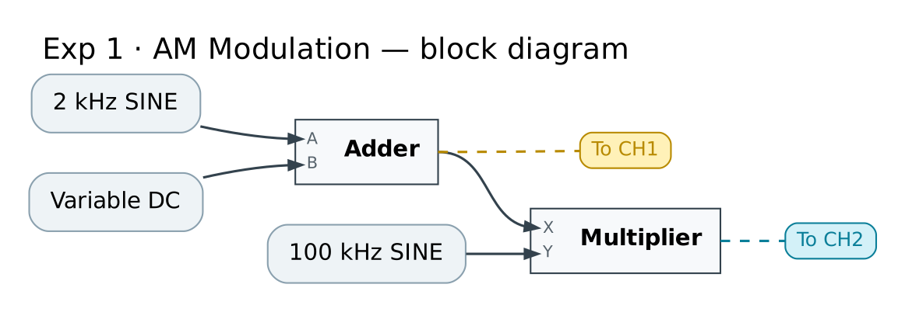

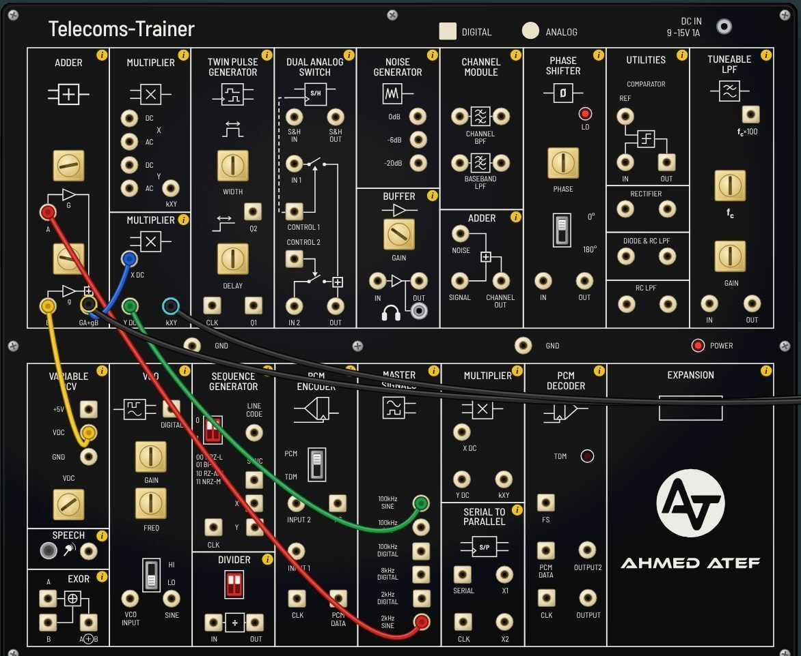

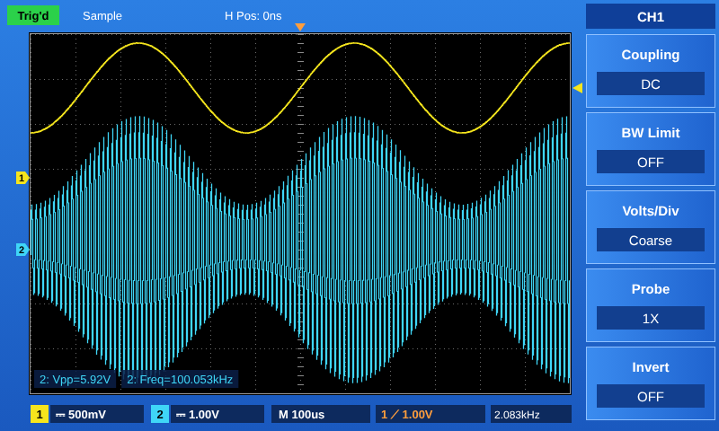

Scope: CH1: ADDER OUT, 0.5 V/div · CH2: MULTIPLIER kXY, 1 V/div · 100 µs/div

- **The book expects:** 1 V DC + 1 Vp-p, and m = 0.5
- **The simulator shows:** 1.004 V + 1.000 Vp-p, and m = 0.500

### Exp 2 · DSBSC Modulation — generating DSBSC with a simple message

*Electrical Testing (6) lab manual, ELC414 (Term 1) · p. 19 · Fig. 4 · adapted from Emona Vol. 1 Exp 5*

Setup file: [`setups/Term1/02-Exp2-DSBSC-Modulation.ett.json`](../../setups/Term1/02-Exp2-DSBSC-Modulation.ett.json)

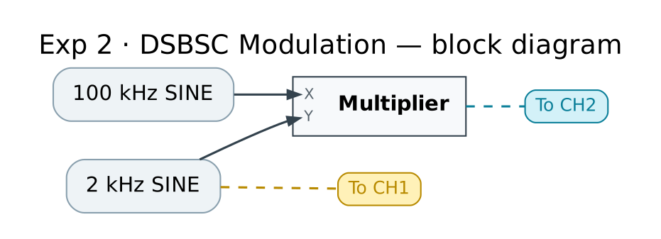

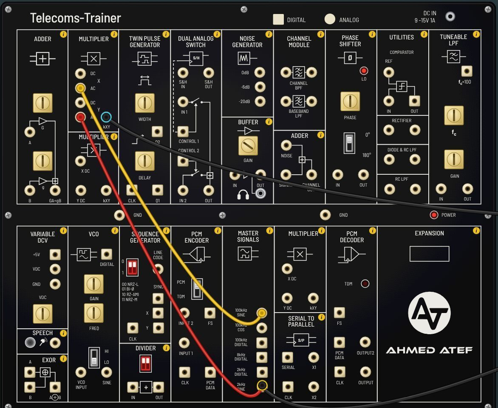

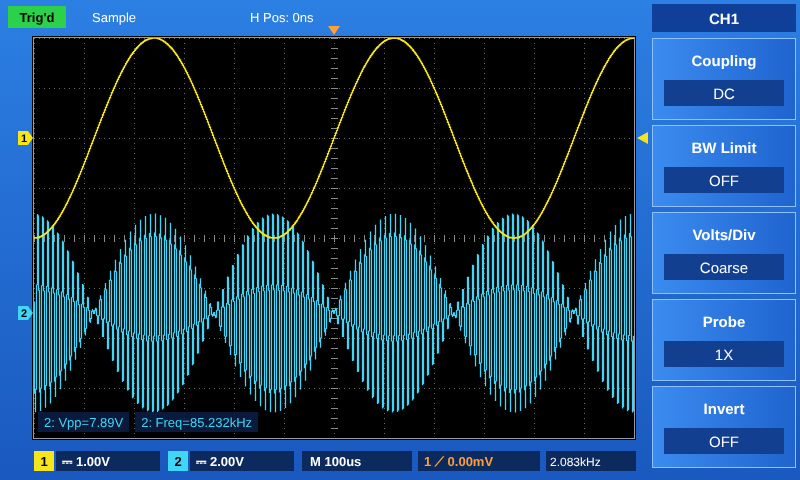

Scope: CH1: MASTER 2 kHz SINE, 1 V/div · CH2: MULTIPLIER kXY, 2 V/div · 100 µs/div

- **The book expects:** 8 Vp-p, envelope = |message|, and the carrier flips phase at every zero crossing of the message
- **The simulator shows:** 7.89 Vp-p, correlation 0.996 with |message|

### Exp 3 · AM Demodulation — recovering the message with an envelope detector

*Electrical Testing (6) lab manual, ELC414 (Term 1) · p. 31 · Fig. 4 · adapted from Emona Vol. 1 Exp 6*

Setup file: [`setups/Term1/03-Exp3-AM-Demodulation.ett.json`](../../setups/Term1/03-Exp3-AM-Demodulation.ett.json)

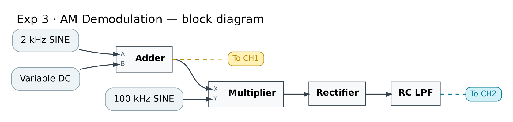

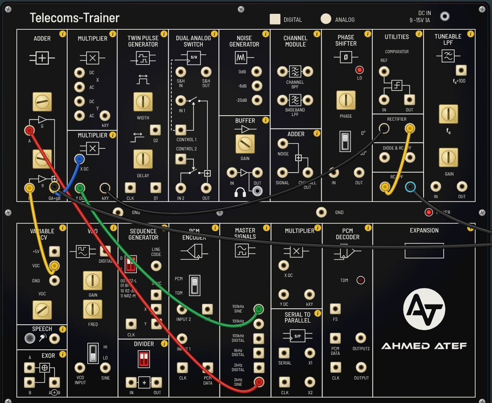

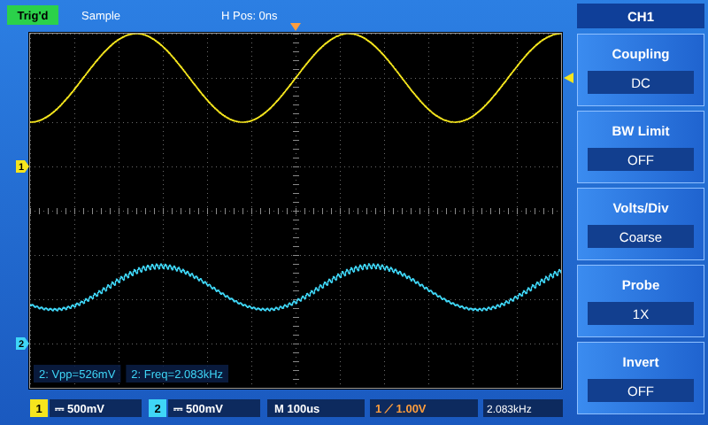

Scope: CH1: ADDER OUT, 0.5 V/div · CH2: RC LPF, 0.5 V/div · 100 µs/div

- **The book expects:** The RC LPF output is a copy of the message
- **The simulator shows:** correlation 0.997, 0.526 Vp-p, with a small carrier ripple like the real kit

### Exp 4 · DSBSC Demodulation — recovering the message with a product detector

*Electrical Testing (6) lab manual, ELC414 (Term 1) · p. 44 · Fig. 4 · adapted from Emona Vol. 1 Exp 7*

Setup file: [`setups/Term1/04-Exp4-DSBSC-Demodulation.ett.json`](../../setups/Term1/04-Exp4-DSBSC-Demodulation.ett.json)

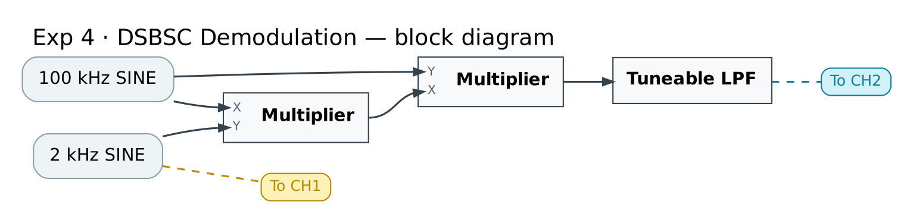

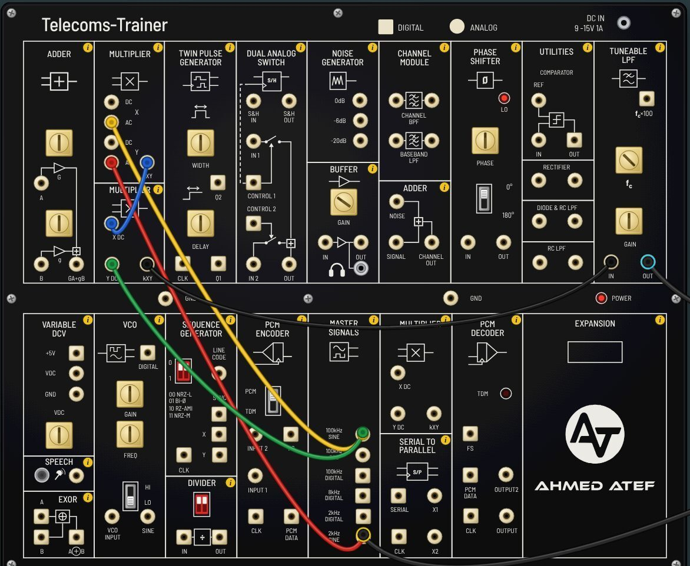

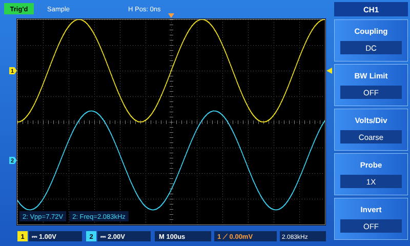

Scope: CH1: MASTER 2 kHz SINE, 1 V/div · CH2: TUNEABLE LPF OUT, 2 V/div · 100 µs/div

- **The book expects:** The message is recovered after the LPF
- **The simulator shows:** correlation 1.000, 7.72 Vp-p

### Exp 4 · Part C — effect of message amplitude on the output (BUFFER)

*Electrical Testing (6) lab manual, ELC414 (Term 1) · p. 46 · Fig. 7 · adapted from Emona Vol. 1 Exp 7*

Setup file: [`setups/Term1/04-Exp4-PartC-Buffer.ett.json`](../../setups/Term1/04-Exp4-PartC-Buffer.ett.json)

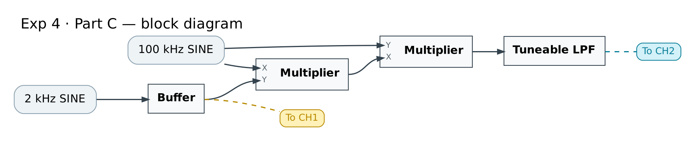

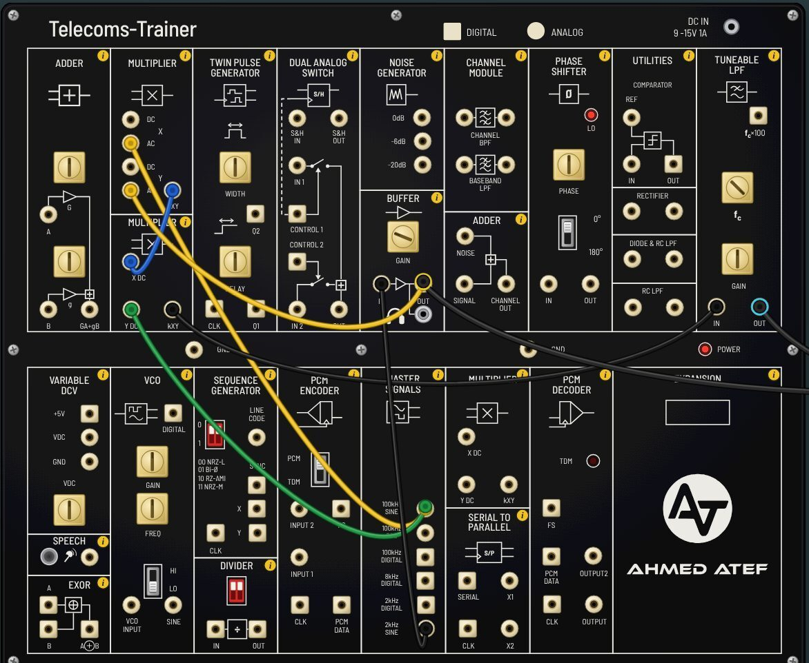

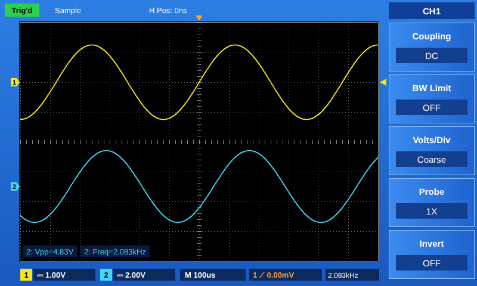

Scope: CH1: BUFFER OUT, 1 V/div · CH2: TUNEABLE LPF OUT, 2 V/div · 100 µs/div

- **The book expects:** The output scales with message amplitude, and overload sets in past half-turn of the BUFFER
- **The simulator shows:** BUFFER 2.50 Vp-p gives 4.83 Vp-p output (= 7.72 × 2.5/4); past half-turn, 16 % clipping

### Exp 4 · VCO carrier — the VCO as the receiver's local carrier

*Electrical Testing (6) lab manual, ELC414 (Term 1) · p. 48 · Steps 33–38 · adapted from Emona Vol. 1 Exp 7*

Setup file: [`setups/Term1/04-Exp4-VCO-Carrier.ett.json`](../../setups/Term1/04-Exp4-VCO-Carrier.ett.json)

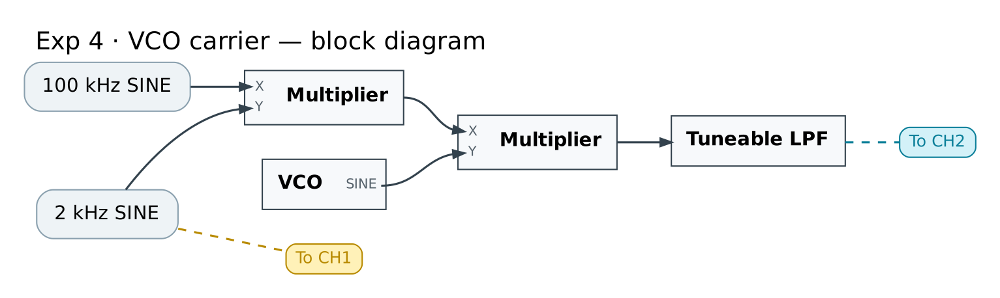

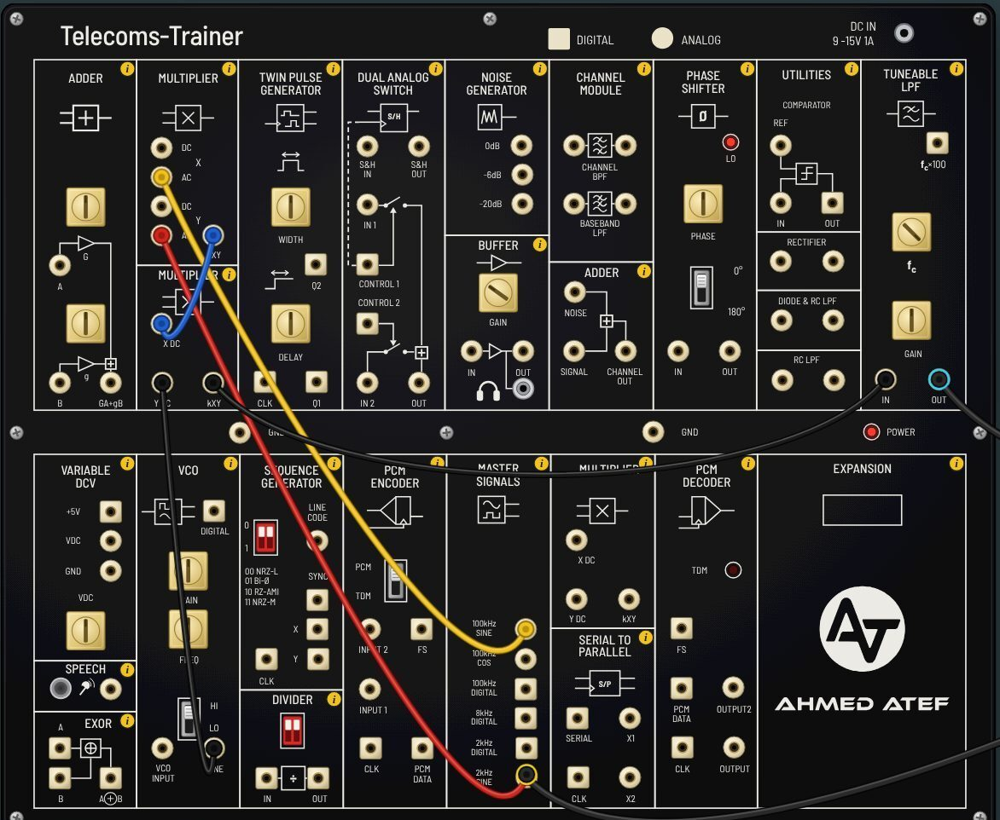

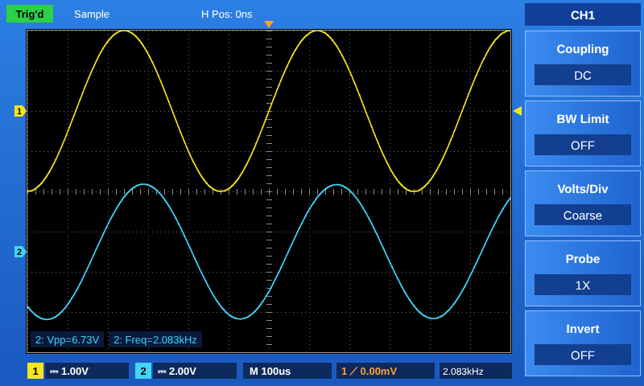

Scope: CH1: MASTER 2 kHz SINE, 1 V/div · CH2: TUNEABLE LPF OUT, 2 V/div · 100 µs/div

- **The book expects:** The VCO is independent of the transmitter carrier, so the recovered message waxes and wanes
- **The simulator shows:** amplitude varies between 3.2 and 6.4 Vp-p
- **Note:** The VCO is free-running, so its frequency drifts slowly (about ±10 Hz at 100 kHz) against the MASTER carrier. That is why the recovered message keeps growing and shrinking, just as on the real kit.

### Exp 5 · SSB Modulation — generating SSB by the phasing method

*Electrical Testing (6) lab manual, ELC414 (Term 1) · p. 55 · Fig. 3 · adapted from Emona Vol. 1 Exp 8*

Setup file: [`setups/Term1/05-Exp5-SSB-Modulation.ett.json`](../../setups/Term1/05-Exp5-SSB-Modulation.ett.json)

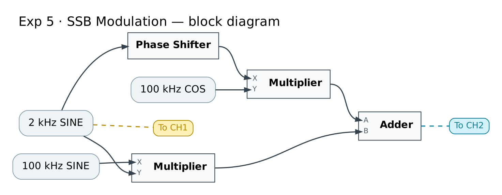

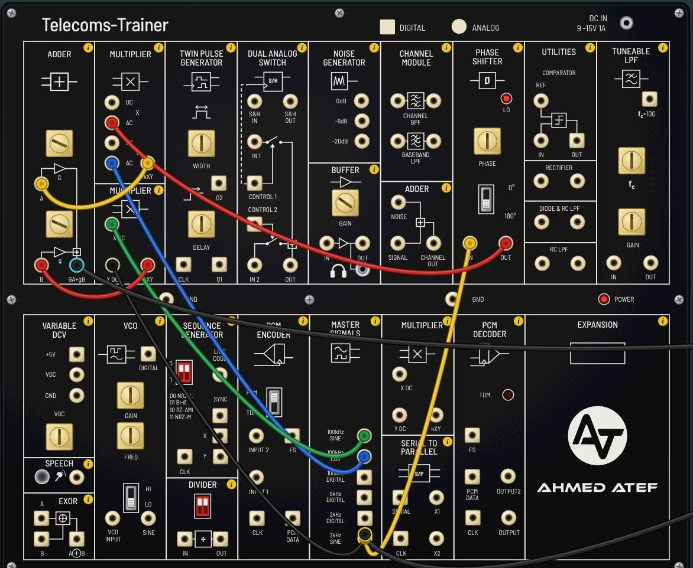

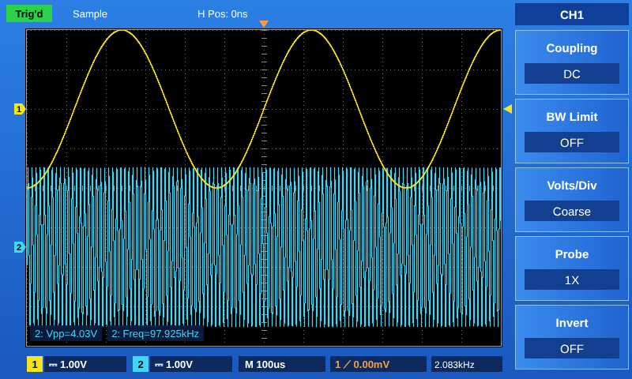

Scope: CH1: MASTER 2 kHz SINE, 1 V/div · CH2: ADDER OUT (SSB), 1 V/div · 100 µs/div

- **The book expects:** A single sine at 97.917 kHz with a flat envelope
- **The simulator shows:** 97.92 kHz, 4.03 Vp-p, flat envelope

### Exp 5 · SSB Demodulation — recovering the message with a product detector

*Electrical Testing (6) lab manual, ELC414 (Term 1) · p. 62 · Fig. 9 · adapted from Emona Vol. 1 Exp 8*

Setup file: [`setups/Term1/05-Exp5-SSB-Demodulation.ett.json`](../../setups/Term1/05-Exp5-SSB-Demodulation.ett.json)

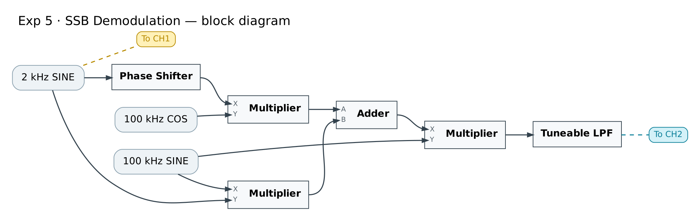

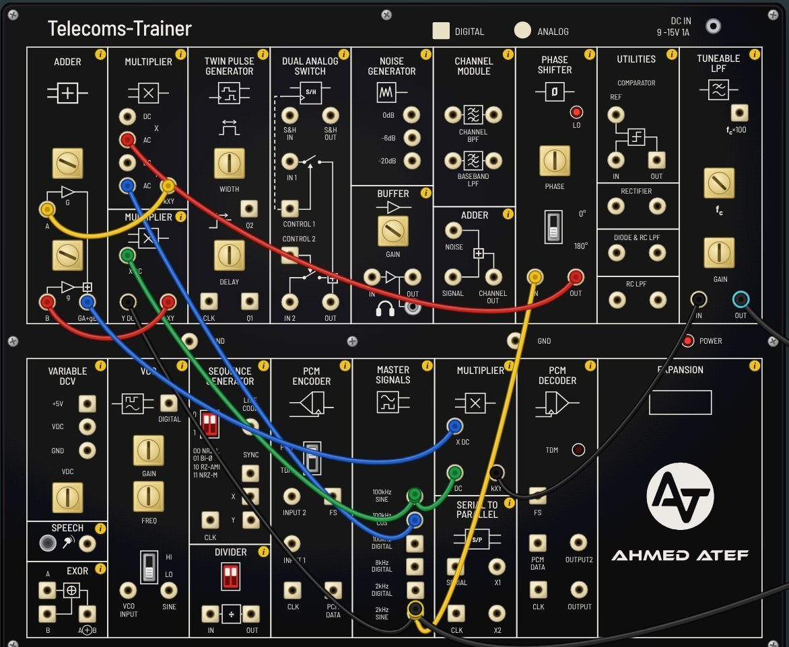

Scope: CH1: MASTER 2 kHz SINE, 1 V/div · CH2: TUNEABLE LPF OUT, 1 V/div · 100 µs/div

- **The book expects:** The 2.083 kHz message is recovered
- **The simulator shows:** correlation 1.000, 3.94 Vp-p

### Exp 6 · FM Modulation — FM with a square-wave message

*Electrical Testing (6) lab manual, ELC414 (Term 1) · p. 67 · Fig. 2 · adapted from Emona Vol. 1 Exp 9*

Setup file: [`setups/Term1/06-Exp6-FM-Modulation.ett.json`](../../setups/Term1/06-Exp6-FM-Modulation.ett.json)

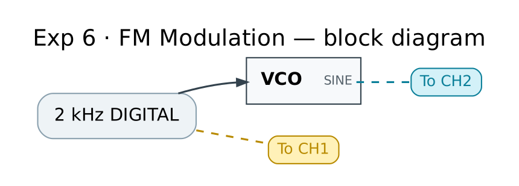

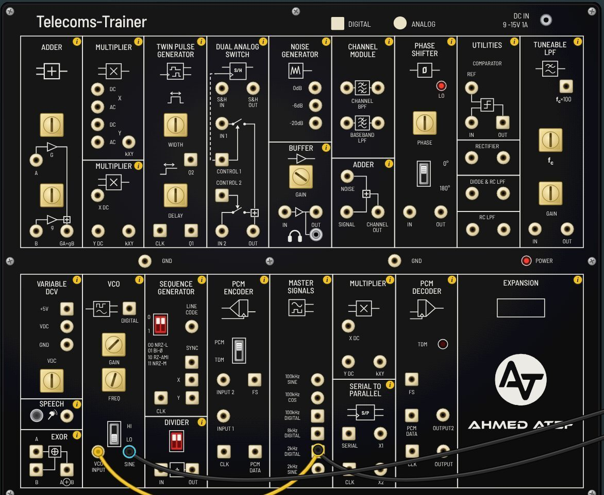

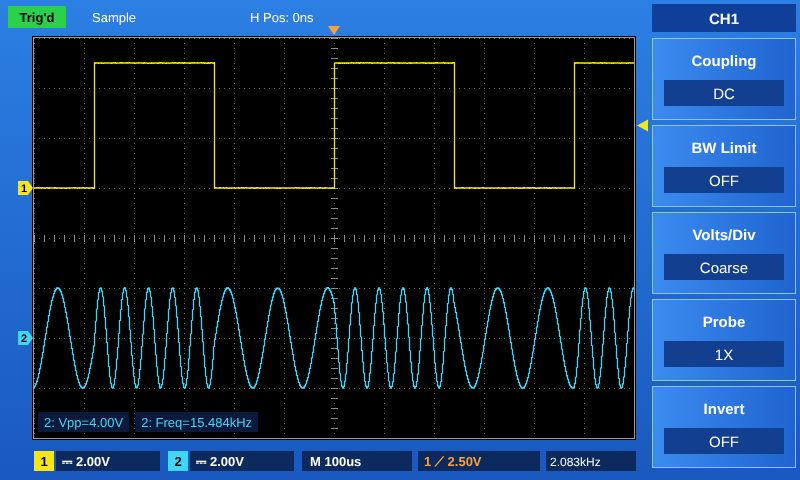

Scope: CH1: MASTER 2 kHz DIGITAL, 2 V/div · CH2: VCO SINE, 2 V/div · 100 µs/div

- **The book expects:** Rest frequency 10 kHz; the frequency switches between two values with the message
- **The simulator shows:** ≈10 kHz at 0 V and ≈21 kHz at 5 V, constant 4.00 Vp-p amplitude

### Exp 6 · Part C — FM with a sine message

*Electrical Testing (6) lab manual, ELC414 (Term 1) · p. 71 · Fig. 6 · adapted from Emona Vol. 1 Exp 9*

Setup file: [`setups/Term1/06-Exp6-PartC-Sine-Message.ett.json`](../../setups/Term1/06-Exp6-PartC-Sine-Message.ett.json)

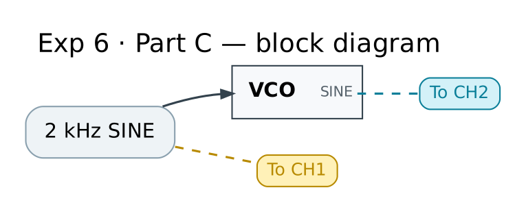

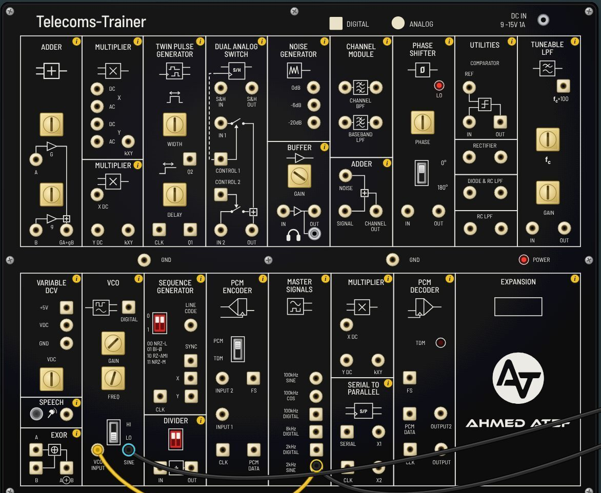

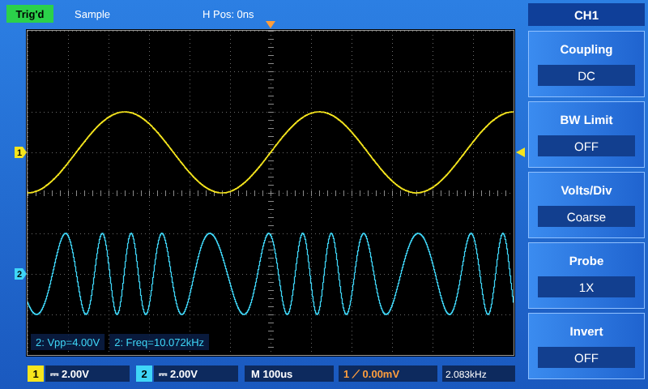

Scope: CH1: MASTER 2 kHz SINE, 2 V/div · CH2: VCO SINE, 2 V/div · 100 µs/div

- **The book expects:** Frequency varies smoothly, highest at the message peak
- **The simulator shows:** 4.00 Vp-p, mean frequency 9.94 kHz

### Exp 7 · FM Demodulation — the zero-crossing detector

*Electrical Testing (6) lab manual, ELC414 (Term 1) · p. 79 · Fig. 6 · adapted from Emona Vol. 1 Exp 10*

Setup file: [`setups/Term1/07-Exp7-FM-Demodulation.ett.json`](../../setups/Term1/07-Exp7-FM-Demodulation.ett.json)

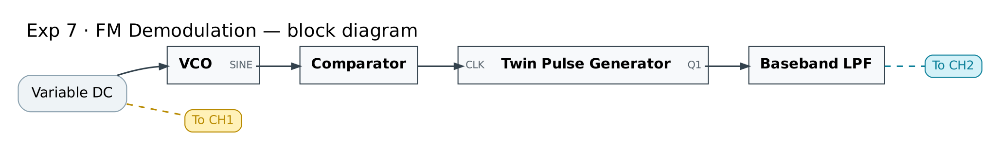

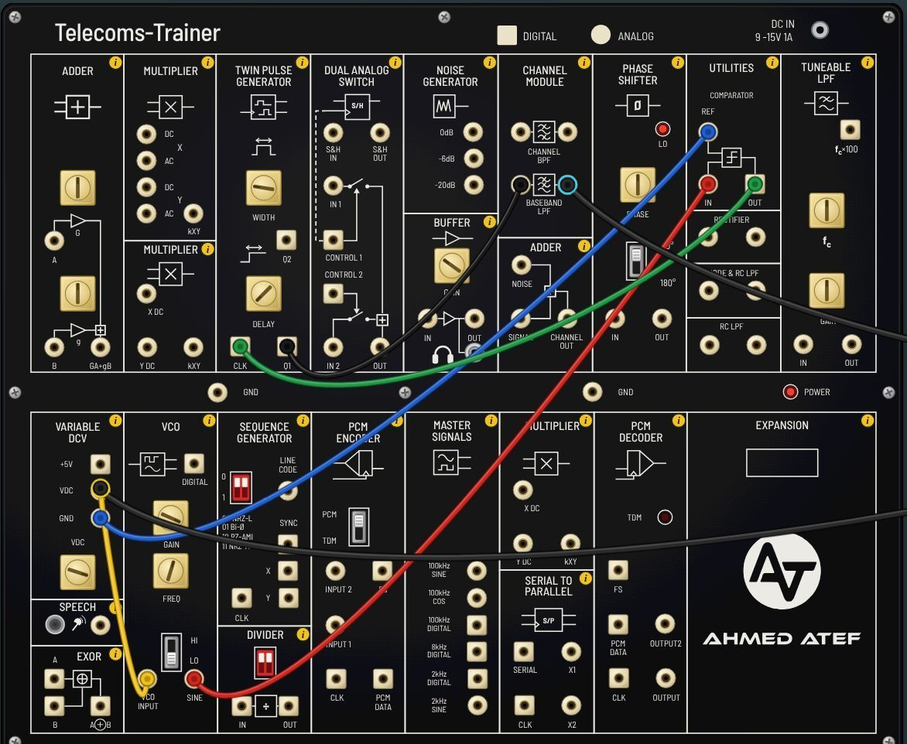

Scope: CH1: VARIABLE DCV, 1 V/div · CH2: BASEBAND LPF, 0.5 V/div · 50 µs/div

- **The book expects:** The DC after the LPF follows VDC, and +2 V gives 15 kHz
- **The simulator shows:** 816 / 544 / 272 mV at +2 / 0 / −2 V, and 15.00 kHz

### Exp 7 · Part C — inside the zero-crossing detector

*Electrical Testing (6) lab manual, ELC414 (Term 1) · p. 84 · Figs. 2, 10–15 · adapted from Emona Vol. 1 Exp 10*

Setup file: none (see the note below)

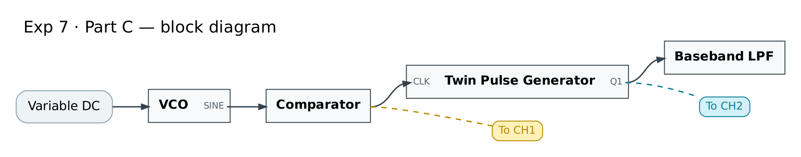

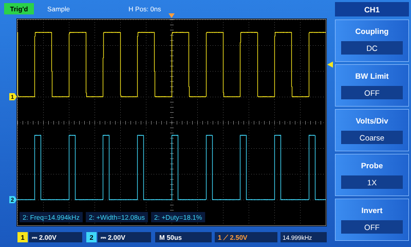

Scope: CH1: COMPARATOR OUT, 2 V/div · CH2: TWIN PULSE Q1 (ZCD), 2 V/div · 50 µs/div

- **The book expects:** The comparator squares up the signal, and the ZCD gives a fixed-width pulse on every rising edge
- **The simulator shows:** fixed 12.08 µs pulse; duty 18.1 % at +2 V and 6.0 % at −2 V
- **Note:** There is no ready-made file for this part: open the Part B setup and move the probes to COMPARATOR OUT (CH1) and TWIN PULSE Q1 (CH2).

### Exp 7 · Part D — sending and recovering a sine by FM

*Electrical Testing (6) lab manual, ELC414 (Term 1) · p. 87 · Fig. 16 · adapted from Emona Vol. 1 Exp 10*

Setup file: [`setups/Term1/07-Exp7-PartD-Sine-Message.ett.json`](../../setups/Term1/07-Exp7-PartD-Sine-Message.ett.json)

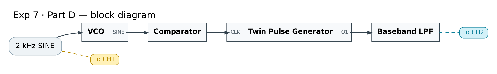

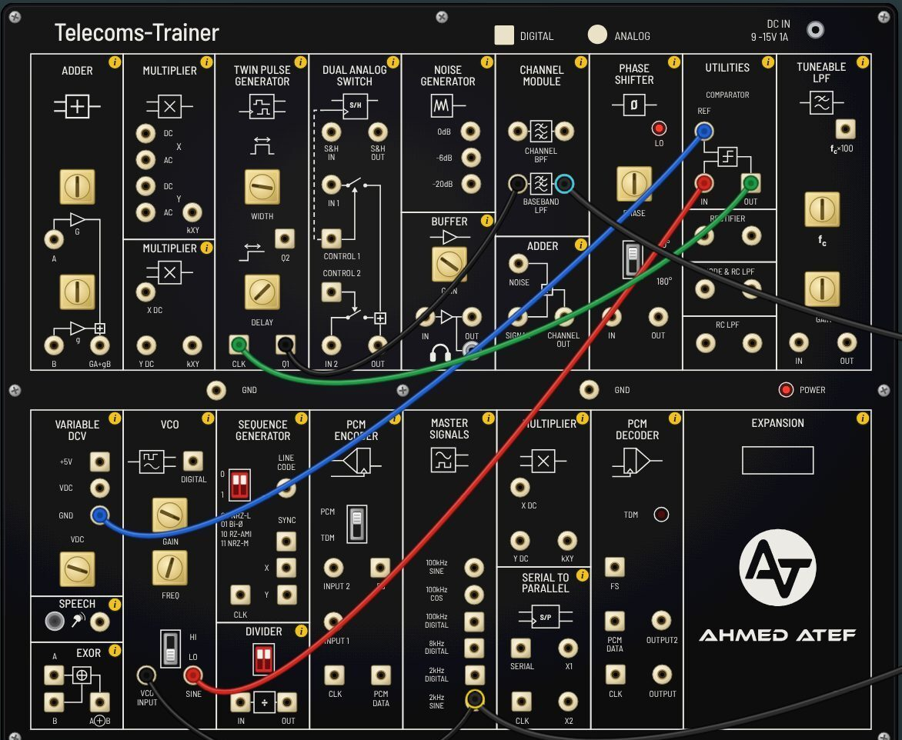

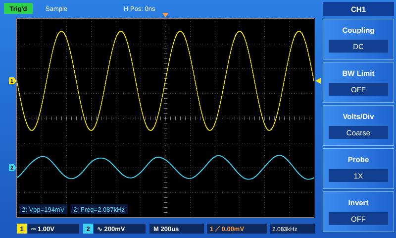

Scope: CH1: MASTER 2 kHz SINE, 1 V/div · CH2: BASEBAND LPF (AC), 0.2 V/div · 200 µs/div

- **The book expects:** The message is recovered, but at small amplitude
- **The simulator shows:** correlation 0.996, 0.196 Vp-p
- **Note:** The amplitude is small because the 2.083 kHz message is above the Baseband LPF cutoff (1.6 kHz). An independent mathematical model gave 193 mV against 195 mV from the simulator, with the same amplitude fluctuation.

## Term 2 — Electrical Testing (7), ELC424

- [Exp 11 · Part A — natural sampling](#exp-11--part-a--natural-sampling)
- [Exp 11 · Part A — sample-and-hold](#exp-11--part-a--sample-and-hold)
- [Exp 11 · Part C — reconstructing the message with the LPF](#exp-11--part-c--reconstructing-the-message-with-the-lpf)
- [Exp 11 · Part D — aliasing](#exp-11--part-d--aliasing)
- [Exp 12 · Part A — PCM code for 0 V](#exp-12--part-a--pcm-code-for-0-v)
- [Exp 12 · Part B — encoding a variable DC voltage](#exp-12--part-b--encoding-a-variable-dc-voltage)
- [Exp 12 · Part D — encoding a sine wave](#exp-12--part-d--encoding-a-sine-wave)
- [Exp 13 · Part B — decoding PCM data](#exp-13--part-b--decoding-pcm-data)
- [Exp 13 · Part D — recovering the message](#exp-13--part-d--recovering-the-message)
- [Exp 15 · Part A — generating ASK](#exp-15--part-a--generating-ask)
- [Exp 15 · Part A — ASK on a 100 kHz VCO carrier](#exp-15--part-a--ask-on-a-100-khz-vco-carrier)
- [Exp 15 · Part B — demodulation with an envelope detector](#exp-15--part-b--demodulation-with-an-envelope-detector)
- [Exp 15 · Part C — recovering the data with the comparator](#exp-15--part-c--recovering-the-data-with-the-comparator)
- [Exp 16 · Part A — generating FSK](#exp-16--part-a--generating-fsk)
- [Exp 16 · Part B — separating one tone with a filter](#exp-16--part-b--separating-one-tone-with-a-filter)
- [Exp 16 · Part B — envelope detector followed by a comparator](#exp-16--part-b--envelope-detector-followed-by-a-comparator)
- [Exp 17 · Part A — generating BPSK](#exp-17--part-a--generating-bpsk)
- [Exp 17 · Part B — demodulation with a product detector](#exp-17--part-b--demodulation-with-a-product-detector)
- [Exp 17 · Part C — recovering the data with the comparator](#exp-17--part-c--recovering-the-data-with-the-comparator)
- [Exp 18 · Part A — splitting the data into X1 and X2](#exp-18--part-a--splitting-the-data-into-x1-and-x2)
- [Exp 18 · Part A — generating QPSK](#exp-18--part-a--generating-qpsk)
- [Exp 18 · Part B — recovering X1 by phase discrimination](#exp-18--part-b--recovering-x1-by-phase-discrimination)
- [Exp 18 · Part B — recovering X1 with the comparator](#exp-18--part-b--recovering-x1-with-the-comparator)
- [Exp 18 · Part B — recovering X2](#exp-18--part-b--recovering-x2)
- [Exp 19 · Part A — generating a DSSS signal](#exp-19--part-a--generating-a-dsss-signal)
- [Exp 19 · Part C — despreading with the correct code](#exp-19--part-c--despreading-with-the-correct-code)
- [Exp 19 · Part C — despreading with the wrong code](#exp-19--part-c--despreading-with-the-wrong-code)
- [Exp 19 · Part D — a jamming signal in the channel](#exp-19--part-d--a-jamming-signal-in-the-channel)
- [Exp 19 · Part D — swept-frequency jamming](#exp-19--part-d--swept-frequency-jamming)
- [Exp 19 · Part D — noise in the channel](#exp-19--part-d--noise-in-the-channel)
- [Vol.2 Exp 6 · Part A — generating the sawtooth](#vol2-exp-6--part-a--generating-the-sawtooth)
- [Vol.2 Exp 6 · Part B — PWM of a DC voltage](#vol2-exp-6--part-b--pwm-of-a-dc-voltage)
- [Vol.2 Exp 6 · Part C — PWM of a sine message](#vol2-exp-6--part-c--pwm-of-a-sine-message)
- [Vol.2 Exp 6 · Part D — recovering the message](#vol2-exp-6--part-d--recovering-the-message)
- [Vol.2 Exp 6 · Part E — when Nyquist is not respected](#vol2-exp-6--part-e--when-nyquist-is-not-respected)
- [Vol.2 Exp 8 · Part A — a 100 % modulated AM signal](#vol2-exp-8--part-a--a-100--modulated-am-signal)
- [Vol.2 Exp 8 · Part B — the PLL locks to the carrier](#vol2-exp-8--part-b--the-pll-locks-to-the-carrier)
- [Vol.2 Exp 9 · Part A — adding noise to the data](#vol2-exp-9--part-a--adding-noise-to-the-data)
- [Vol.2 Exp 9 · Part B — band-limiting the noisy signal](#vol2-exp-9--part-b--band-limiting-the-noisy-signal)
- [Vol.2 Exp 16 · Part A — setting up the delta modulator](#vol2-exp-16--part-a--setting-up-the-delta-modulator)
- [Vol.2 Exp 16 — the delta signal (larger step)](#vol2-exp-16--the-delta-signal-larger-step)
- [Vol.2 Exp 16 · Part C — delta demodulation](#vol2-exp-16--part-c--delta-demodulation)
- [Vol.2 Exp 16 · Part D — signal to noise and distortion ratio (SNDR)](#vol2-exp-16--part-d--signal-to-noise-and-distortion-ratio-sndr)
- [Vol.2 Exp 17 · Part A — setting up the delta-sigma modulator](#vol2-exp-17--part-a--setting-up-the-delta-sigma-modulator)
- [Vol.2 Exp 17 · Part A — delta-sigma pulses](#vol2-exp-17--part-a--delta-sigma-pulses)
- [Vol.2 Exp 17 · Part B — delta-sigma demodulation](#vol2-exp-17--part-b--delta-sigma-demodulation)

### Exp 11 · Part A — natural sampling

*Electrical Testing (7) lab manual, ELC424 (Term 2) · p. 4 · Fig. 2 · adapted from Emona Vol. 1 Exp 11*

Setup file: [`setups/Term2/01-Exp11-A-Natural-Sampling.ett.json`](../../setups/Term2/01-Exp11-A-Natural-Sampling.ett.json)

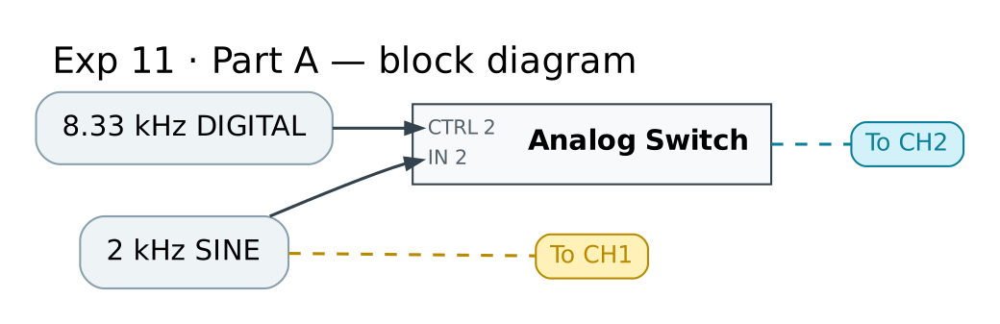

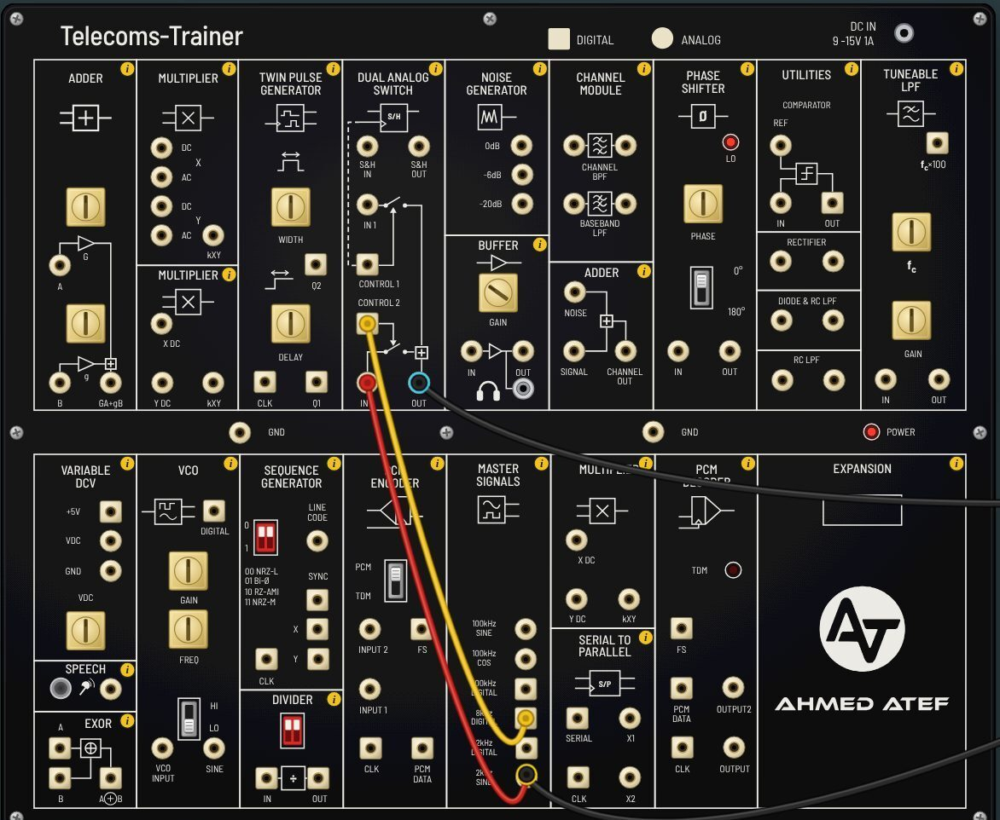

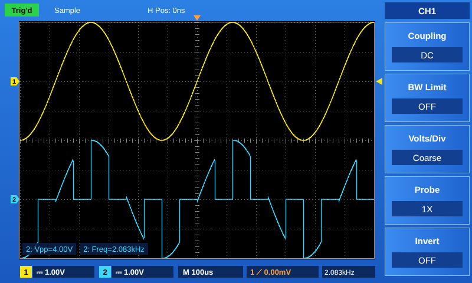

- **The book expects:** Samples follow the message while the 8.33 kHz clock is high, and are zero otherwise
- **The simulator shows:** samples 4.00 Vp-p following the message

### Exp 11 · Part A — sample-and-hold

*Electrical Testing (7) lab manual, ELC424 (Term 2) · p. 7 · Fig. 4 · adapted from Emona Vol. 1 Exp 11*

Setup file: [`setups/Term2/01-Exp11-A-Sample-and-Hold.ett.json`](../../setups/Term2/01-Exp11-A-Sample-and-Hold.ett.json)

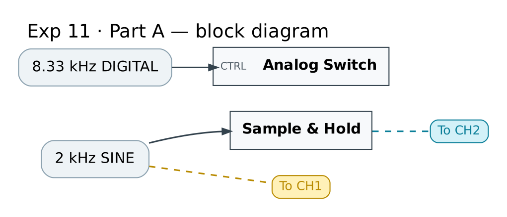

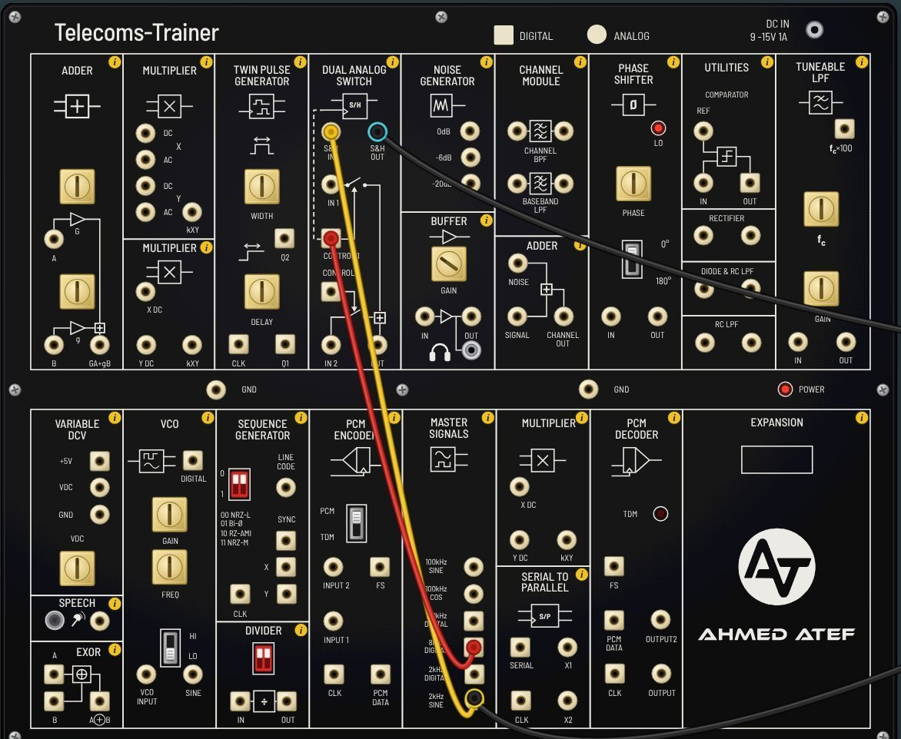

- **The book expects:** The output holds each sample until the next, giving a staircase
- **The simulator shows:** 8300 steps per second (8.33 kHz)

### Exp 11 · Part C — reconstructing the message with the LPF

*Electrical Testing (7) lab manual, ELC424 (Term 2) · p. 10 · Fig. 7 · adapted from Emona Vol. 1 Exp 11*

Setup file: [`setups/Term2/01-Exp11-C-Reconstruction.ett.json`](../../setups/Term2/01-Exp11-C-Reconstruction.ett.json)

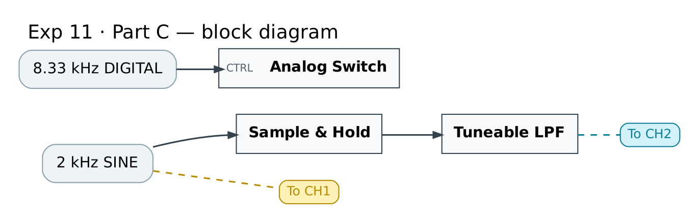

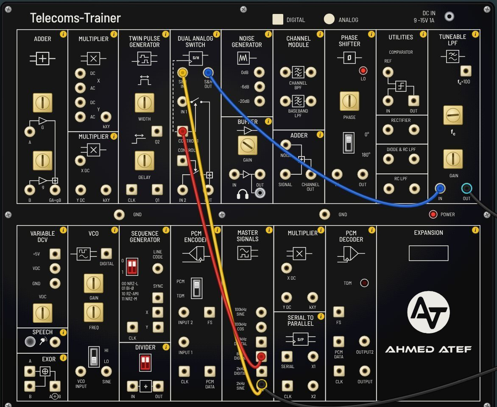

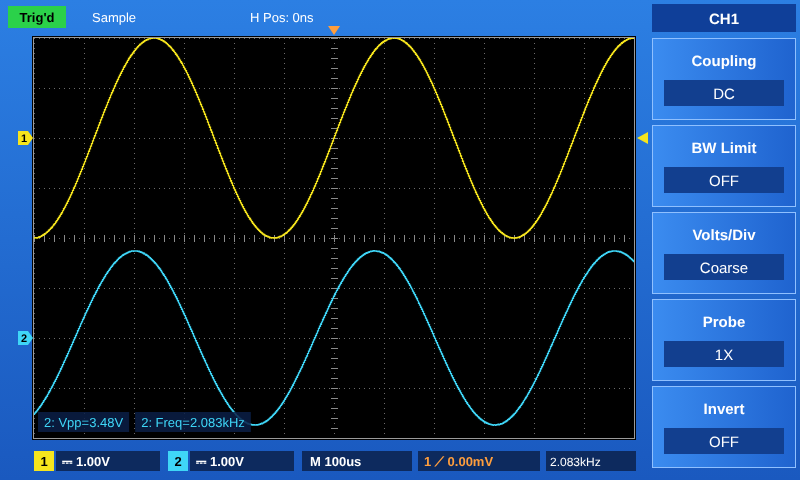

- **The book expects:** The TUNEABLE LPF recovers the message once fc is a little above 2 kHz
- **The simulator shows:** correlation 1.000, 3.48 Vp-p

### Exp 11 · Part D — aliasing

*Electrical Testing (7) lab manual, ELC424 (Term 2) · p. 13 · Fig. 9 · adapted from Emona Vol. 1 Exp 11*

Setup file: [`setups/Term2/01-Exp11-D-Aliasing.ett.json`](../../setups/Term2/01-Exp11-D-Aliasing.ett.json)

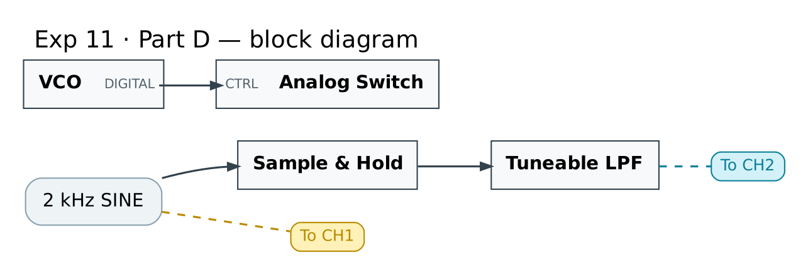

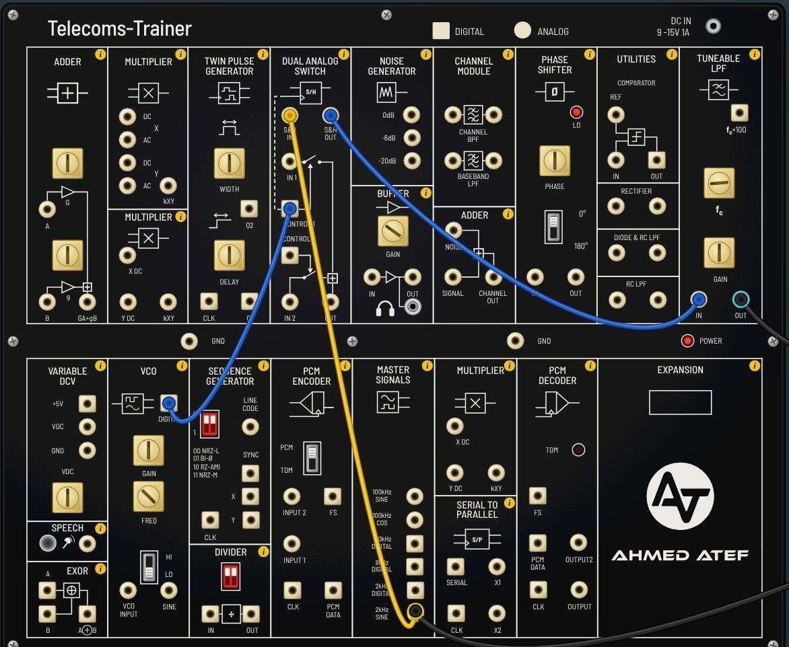

- **The book expects:** When the sample rate drops below twice the message frequency, the output is the wrong signal
- **The simulator shows:** at 17 kHz: correlation 1.000. At 3.2 kHz: 0.471, i.e. aliasing

### Exp 12 · Part A — PCM code for 0 V

*Electrical Testing (7) lab manual, ELC424 (Term 2) · p. 22 · Fig. 5 · adapted from Emona Vol. 1 Exp 12*

Setup file: [`setups/Term2/02-Exp12-A-PCM-0V.ett.json`](../../setups/Term2/02-Exp12-A-PCM-0V.ett.json)

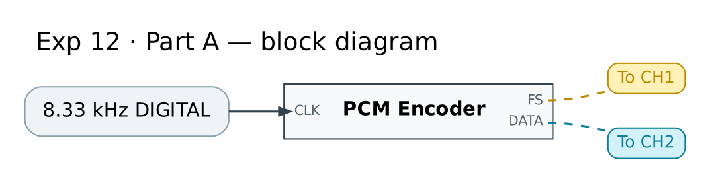

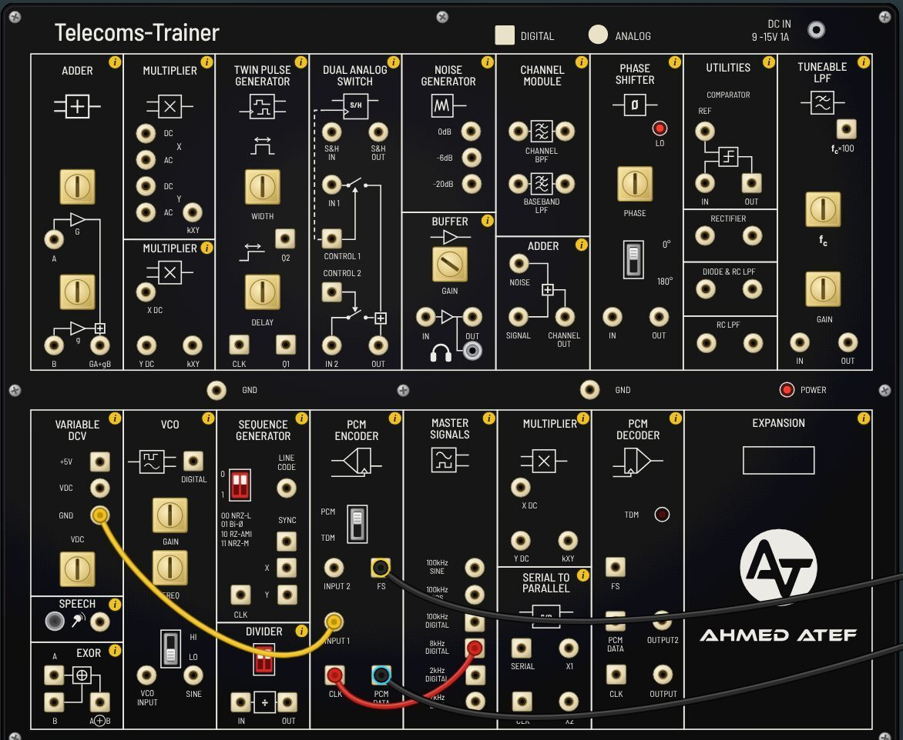

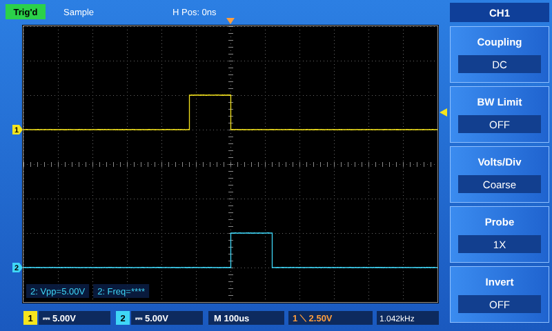

- **The book expects:** 0 V gives code 10000000, with FS just before the MSB
- **The simulator shows:** code 10000000

### Exp 12 · Part B — encoding a variable DC voltage

*Electrical Testing (7) lab manual, ELC424 (Term 2) · p. 24 · Fig. 7 · adapted from Emona Vol. 1 Exp 12*

Setup file: [`setups/Term2/02-Exp12-B-PCM-Variable-DC.ett.json`](../../setups/Term2/02-Exp12-B-PCM-Variable-DC.ett.json)

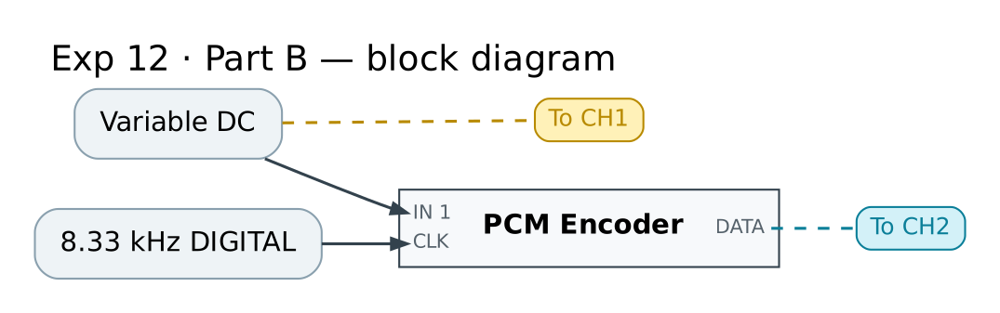

- **The book expects:** The code changes as VDC is turned
- **The simulator shows:** VDC starts at 0 V, so the code is 10000000 until it is turned

### Exp 12 · Part D — encoding a sine wave

*Electrical Testing (7) lab manual, ELC424 (Term 2) · p. 29 · Fig. 9 · adapted from Emona Vol. 1 Exp 12*

Setup file: [`setups/Term2/02-Exp12-D-PCM-Sinewave.ett.json`](../../setups/Term2/02-Exp12-D-PCM-Sinewave.ett.json)

- **The book expects:** The code changes frame to frame with the sine. The bit clock is the VCO on HI at minimum frequency (the book says about 50 kHz)
- **The simulator shows:** bit clock 60 kHz, one frame every 133 µs (7.5 kHz)
- **Note:** The book says about 50 kHz; the Emona specifications give 60 kHz as the VCO minimum on HI. The simulator follows the specifications.

### Exp 13 · Part B — decoding PCM data

*Electrical Testing (7) lab manual, ELC424 (Term 2) · p. 36 · Fig. 5 · adapted from Emona Vol. 1 Exp 13*

Setup file: [`setups/Term2/03-Exp13-B-PCM-Decoding.ett.json`](../../setups/Term2/03-Exp13-B-PCM-Decoding.ett.json)

- **The book expects:** The decoder output is the message as a staircase
- **The simulator shows:** correlation 0.989, 4.00 Vp-p

### Exp 13 · Part D — recovering the message

*Electrical Testing (7) lab manual, ELC424 (Term 2) · p. 40 · Fig. 10 · adapted from Emona Vol. 1 Exp 13*

Setup file: [`setups/Term2/03-Exp13-D-Recovering-Message.ett.json`](../../setups/Term2/03-Exp13-D-Recovering-Message.ett.json)

- **The book expects:** The LPF smooths the steps and recovers the message
- **The simulator shows:** correlation 1.000

### Exp 15 · Part A — generating ASK

*Electrical Testing (7) lab manual, ELC424 (Term 2) · p. 46 · Fig. 2 · adapted from Emona Vol. 1 Exp 15*

Setup file: [`setups/Term2/04-Exp15-A-ASK-Generation.ett.json`](../../setups/Term2/04-Exp15-A-ASK-Generation.ett.json)

- **The book expects:** The 2 kHz sine appears during a 1 and disappears during a 0
- **The simulator shows:** 4.00 Vp-p on a 1, no carrier on a 0

### Exp 15 · Part A — ASK on a 100 kHz VCO carrier

*Electrical Testing (7) lab manual, ELC424 (Term 2) · p. 49 · Fig. 4 · adapted from Emona Vol. 1 Exp 15*

Setup file: [`setups/Term2/04-Exp15-A-ASK-100kHz-Carrier.ett.json`](../../setups/Term2/04-Exp15-A-ASK-100kHz-Carrier.ett.json)

- **The book expects:** Same idea with a 100 kHz VCO carrier
- **The simulator shows:** 1.79 Vp-p
- **Note:** The amplitude is below 4 Vp-p because the Dual Analog Switch bandwidth is only 50 kHz (Emona specifications), so about 45 % of the 100 kHz gets through.

### Exp 15 · Part B — demodulation with an envelope detector

*Electrical Testing (7) lab manual, ELC424 (Term 2) · p. 51 · Fig. 6 · adapted from Emona Vol. 1 Exp 15*

Setup file: [`setups/Term2/04-Exp15-B-ASK-Envelope-Detection.ett.json`](../../setups/Term2/04-Exp15-B-ASK-Envelope-Detection.ett.json)

- **The book expects:** The rectifier and LPF recover the data, slightly rounded (Question 4)
- **The simulator shows:** correlation 0.989

### Exp 15 · Part C — recovering the data with the comparator

*Electrical Testing (7) lab manual, ELC424 (Term 2) · p. 53 · Fig. 8 · adapted from Emona Vol. 1 Exp 15*

Setup file: [`setups/Term2/04-Exp15-C-ASK-Comparator.ett.json`](../../setups/Term2/04-Exp15-C-ASK-Comparator.ett.json)

- **The book expects:** The comparator recovers clean data
- **The simulator shows:** 100 % match with the original

### Exp 16 · Part A — generating FSK

*Electrical Testing (7) lab manual, ELC424 (Term 2) · p. 60 · Fig. 2 · adapted from Emona Vol. 1 Exp 16*

Setup file: [`setups/Term2/05-Exp16-A-FSK-Generation.ett.json`](../../setups/Term2/05-Exp16-A-FSK-Generation.ett.json)

- **The book expects:** A different frequency for each bit; a 1 is the higher frequency
- **The simulator shows:** 0 → 2.10 kHz, 1 → 8.91 kHz

### Exp 16 · Part B — separating one tone with a filter

*Electrical Testing (7) lab manual, ELC424 (Term 2) · p. 63 · Fig. 4 · adapted from Emona Vol. 1 Exp 16*

Setup file: [`setups/Term2/05-Exp16-B-FSK-Filtering.ett.json`](../../setups/Term2/05-Exp16-B-FSK-Filtering.ett.json)

- **The book expects:** The filter passes only one tone, so the output resembles ASK
- **The simulator shows:** passes the 0 tone (correlation −0.770 with the data)

### Exp 16 · Part B — envelope detector followed by a comparator

*Electrical Testing (7) lab manual, ELC424 (Term 2) · p. 64 · Figs. 6–8 · adapted from Emona Vol. 1 Exp 16*

Setup file: [`setups/Term2/05-Exp16-C-FSK-Envelope-and-Comparator.ett.json`](../../setups/Term2/05-Exp16-C-FSK-Envelope-and-Comparator.ett.json)

- **The book expects:** The envelope detector followed by the comparator recovers the data
- **The simulator shows:** 99.1 % match, inverted because the filter passes the 0 tone

### Exp 17 · Part A — generating BPSK

*Electrical Testing (7) lab manual, ELC424 (Term 2) · p. 71 · Fig. 2 · adapted from Emona Vol. 1 Exp 17*

Setup file: [`setups/Term2/06-Exp17-A-BPSK-Generation.ett.json`](../../setups/Term2/06-Exp17-A-BPSK-Generation.ett.json)

- **The book expects:** The carrier flips phase by 180° at every data transition
- **The simulator shows:** 7.89 Vp-p

### Exp 17 · Part B — demodulation with a product detector

*Electrical Testing (7) lab manual, ELC424 (Term 2) · p. 73 · Fig. 4 · adapted from Emona Vol. 1 Exp 17*

Setup file: [`setups/Term2/06-Exp17-B-BPSK-Product-Detector.ett.json`](../../setups/Term2/06-Exp17-B-BPSK-Product-Detector.ett.json)

- **The book expects:** The data is recovered, but not an exact copy (Question 3)
- **The simulator shows:** correlation 0.951, 11.1 Vp-p due to ringing

### Exp 17 · Part C — recovering the data with the comparator

*Electrical Testing (7) lab manual, ELC424 (Term 2) · p. 75 · Fig. 6 · adapted from Emona Vol. 1 Exp 17*

Setup file: [`setups/Term2/06-Exp17-C-BPSK-Comparator.ett.json`](../../setups/Term2/06-Exp17-C-BPSK-Comparator.ett.json)

- **The book expects:** The comparator recovers clean data
- **The simulator shows:** 99.3 % match

### Exp 18 · Part A — splitting the data into X1 and X2

*Electrical Testing (7) lab manual, ELC424 (Term 2) · p. 80 · Fig. 3 · adapted from Emona Vol. 1 Exp 18*

Setup file: [`setups/Term2/07-Exp18-A-QPSK-Serial-to-Parallel.ett.json`](../../setups/Term2/07-Exp18-A-QPSK-Serial-to-Parallel.ett.json)

- **The book expects:** X1 and X2 each take one bit of every two
- **The simulator shows:** X1 and X2 each 4.00 Vp-p

### Exp 18 · Part A — generating QPSK

*Electrical Testing (7) lab manual, ELC424 (Term 2) · p. 82 · Figs. 5–9 · adapted from Emona Vol. 1 Exp 18*

Setup file: [`setups/Term2/07-Exp18-A-QPSK-Generation.ett.json`](../../setups/Term2/07-Exp18-A-QPSK-Generation.ett.json)

- **The book expects:** The sum of two 4 Vp-p BPSK signals
- **The simulator shows:** 5.67 Vp-p, i.e. 4 × √2

### Exp 18 · Part B — recovering X1 by phase discrimination

*Electrical Testing (7) lab manual, ELC424 (Term 2) · p. 88 · Fig. 11 · adapted from Emona Vol. 1 Exp 18*

Setup file: [`setups/Term2/07-Exp18-B-QPSK-Recover-X1.ett.json`](../../setups/Term2/07-Exp18-B-QPSK-Recover-X1.ett.json)

- **The book expects:** Phase discrimination recovers X1 without X2
- **The simulator shows:** correlation 0.943 with X1, 0.260 with X2

### Exp 18 · Part B — recovering X1 with the comparator

*Electrical Testing (7) lab manual, ELC424 (Term 2) · p. 90 · Fig. 13 · adapted from Emona Vol. 1 Exp 18*

Setup file: [`setups/Term2/07-Exp18-B-QPSK-Comparator.ett.json`](../../setups/Term2/07-Exp18-B-QPSK-Comparator.ett.json)

- **The book expects:** The comparator recovers a clean X1
- **The simulator shows:** 99.6 % match

### Exp 18 · Part B — recovering X2

*Electrical Testing (7) lab manual, ELC424 (Term 2) · p. 91 · Steps 46–47 · adapted from Emona Vol. 1 Exp 18*

Setup file: [`setups/Term2/07-Exp18-B-QPSK-Recover-X2.ett.json`](../../setups/Term2/07-Exp18-B-QPSK-Recover-X2.ett.json)

- **The book expects:** At 180°, X2 is recovered
- **The simulator shows:** correlation −0.989 with X2 (inverted), 0.033 with X1

### Exp 19 · Part A — generating a DSSS signal

*Electrical Testing (7) lab manual, ELC424 (Term 2) · p. 95 · Fig. 1 · adapted from Emona Vol. 1 Exp 19*

Setup file: [`setups/Term2/08-Exp19-A-DSSS-Generation.ett.json`](../../setups/Term2/08-Exp19-A-DSSS-Generation.ett.json)

- **The book expects:** The message multiplied by the PN sequence, so the signal looks like noise
- **The simulator shows:** 8.00 Vp-p

### Exp 19 · Part C — despreading with the correct code

*Electrical Testing (7) lab manual, ELC424 (Term 2) · p. 98 · Fig. 4 · adapted from Emona Vol. 1 Exp 19*

Setup file: [`setups/Term2/08-Exp19-C-DSSS-Demodulation.ett.json`](../../setups/Term2/08-Exp19-C-DSSS-Demodulation.ett.json)

- **The book expects:** With the same code, the message is recovered
- **The simulator shows:** correlation 1.000, 19.9 Vp-p

### Exp 19 · Part C — despreading with the wrong code

*Electrical Testing (7) lab manual, ELC424 (Term 2) · p. 100 · Fig. 7 · adapted from Emona Vol. 1 Exp 19*

Setup file: [`setups/Term2/08-Exp19-C-DSSS-Wrong-Code.ett.json`](../../setups/Term2/08-Exp19-C-DSSS-Wrong-Code.ett.json)

- **The book expects:** With the wrong code, there is no message
- **The simulator shows:** correlation 0.083, i.e. no message

### Exp 19 · Part D — a jamming signal in the channel

*Electrical Testing (7) lab manual, ELC424 (Term 2) · p. 101 · Fig. 8 · adapted from Emona Vol. 1 Exp 19*

Setup file: [`setups/Term2/08-Exp19-D-DSSS-Jamming.ett.json`](../../setups/Term2/08-Exp19-D-DSSS-Jamming.ett.json)

- **The book expects:** The message gets through despite the jamming
- **The simulator shows:** correlation 0.999

### Exp 19 · Part D — swept-frequency jamming

*Electrical Testing (7) lab manual, ELC424 (Term 2) · p. 103 · Fig. 10 · adapted from Emona Vol. 1 Exp 19*

Setup file: [`setups/Term2/08-Exp19-D-DSSS-Swept-Jamming.ett.json`](../../setups/Term2/08-Exp19-D-DSSS-Swept-Jamming.ett.json)

- **The book expects:** The message gets through even though the jamming frequency varies
- **The simulator shows:** correlation 0.996

### Exp 19 · Part D — noise in the channel

*Electrical Testing (7) lab manual, ELC424 (Term 2) · p. 104 · Fig. 11 · adapted from Emona Vol. 1 Exp 19*

Setup file: [`setups/Term2/08-Exp19-D-DSSS-Noise.ett.json`](../../setups/Term2/08-Exp19-D-DSSS-Noise.ett.json)

- **The book expects:** The message gets through despite the noise
- **The simulator shows:** correlation 0.999

### Vol.2 Exp 6 · Part A — generating the sawtooth

*Electrical Testing (7) lab manual, ELC424 (Term 2) · p. 110 · Fig. 4 · adapted from Emona Vol. 2 Exp 6*

Setup file: [`setups/Term2/09-Exp6-Vol2-A-PWM-Sawtooth.ett.json`](../../setups/Term2/09-Exp6-Vol2-A-PWM-Sawtooth.ett.json)

- **The book expects:** A sawtooth at about 8 kHz
- **The simulator shows:** 8.33 kHz, 3.40 Vp-p

### Vol.2 Exp 6 · Part B — PWM of a DC voltage

*Electrical Testing (7) lab manual, ELC424 (Term 2) · p. 112 · Figs. 6–8 · adapted from Emona Vol. 2 Exp 6*

Setup file: [`setups/Term2/09-Exp6-Vol2-B-PWM-DC-Input.ett.json`](../../setups/Term2/09-Exp6-Vol2-B-PWM-DC-Input.ett.json)

- **The book expects:** Pulses whose width is set by the DC level
- **The simulator shows:** duty 33 %, with the DC at mid-sawtooth

### Vol.2 Exp 6 · Part C — PWM of a sine message

*Electrical Testing (7) lab manual, ELC424 (Term 2) · p. 117 · Fig. 10 · adapted from Emona Vol. 2 Exp 6*

Setup file: [`setups/Term2/09-Exp6-Vol2-C-PWM-Sine-Message.ett.json`](../../setups/Term2/09-Exp6-Vol2-C-PWM-Sine-Message.ett.json)

- **The book expects:** Pulse width varies with the message
- **The simulator shows:** width varies from 12 to 99 µs

### Vol.2 Exp 6 · Part D — recovering the message

*Electrical Testing (7) lab manual, ELC424 (Term 2) · p. 122 · Fig. 14 · adapted from Emona Vol. 2 Exp 6*

Setup file: [`setups/Term2/09-Exp6-Vol2-D-PWM-Demodulation.ett.json`](../../setups/Term2/09-Exp6-Vol2-D-PWM-Demodulation.ett.json)

- **The book expects:** The LPF recovers the message
- **The simulator shows:** correlation 1.000

### Vol.2 Exp 6 · Part E — when Nyquist is not respected

*Electrical Testing (7) lab manual, ELC424 (Term 2) · p. 126 · adapted from Emona Vol. 2 Exp 6*

Setup file: [`setups/Term2/09-Exp6-Vol2-E-PWM-Nyquist.ett.json`](../../setups/Term2/09-Exp6-Vol2-E-PWM-Nyquist.ett.json)

- **The book expects:** When the message frequency exceeds half the sample rate, the output is no longer the message
- **The simulator shows:** 17 kHz message: output 0.64 Vp-p and not the message

### Vol.2 Exp 8 · Part A — a 100 % modulated AM signal

*Electrical Testing (7) lab manual, ELC424 (Term 2) · p. 137 · Fig. 5 · adapted from Emona Vol. 2 Exp 8*

Setup file: [`setups/Term2/10-Exp8-Vol2-A-PLL-AM-Signal.ett.json`](../../setups/Term2/10-Exp8-Vol2-A-PLL-AM-Signal.ett.json)

- **The book expects:** An 8.33 kHz, 4 Vp-p sine on about 2 V DC, giving 100 % modulated AM
- **The simulator shows:** 4.00 Vp-p and 1.57 V DC
- **Note:** The DC is 1.57 V, not 2 V, because it comes from filtering a 0/5 V square wave, where the DC-to-peak ratio is fixed (π/4) whatever the gain. The real kit gives the same figure.

### Vol.2 Exp 8 · Part B — the PLL locks to the carrier

*Electrical Testing (7) lab manual, ELC424 (Term 2) · p. 141 · Fig. 8 · adapted from Emona Vol. 2 Exp 8*

Setup file: [`setups/Term2/10-Exp8-Vol2-B-PLL-Lock.ett.json`](../../setups/Term2/10-Exp8-Vol2-B-PLL-Lock.ett.json)

- **The book expects:** The VCO locks to the 100 kHz carrier
- **The simulator shows:** the VCO started 400 Hz away and locked to 100.000 kHz

### Vol.2 Exp 9 · Part A — adding noise to the data

*Electrical Testing (7) lab manual, ELC424 (Term 2) · p. 146 · Fig. 1 · adapted from Emona Vol. 2 Exp 9*

Setup file: [`setups/Term2/11-Exp9-Vol2-A-Noisy-Data.ett.json`](../../setups/Term2/11-Exp9-Vol2-A-Noisy-Data.ett.json)

- **The book expects:** Noisy data
- **The simulator shows:** 7.52 Vp-p

### Vol.2 Exp 9 · Part B — band-limiting the noisy signal

*Electrical Testing (7) lab manual, ELC424 (Term 2) · p. 149 · Fig. 3 · adapted from Emona Vol. 2 Exp 9*

Setup file: [`setups/Term2/11-Exp9-Vol2-B-Band-Limited.ett.json`](../../setups/Term2/11-Exp9-Vol2-B-Band-Limited.ett.json)

- **The book expects:** The Baseband LPF removes most of the noise
- **The simulator shows:** remaining noise power 0.01 %

### Vol.2 Exp 16 · Part A — setting up the delta modulator

*Electrical Testing (7) lab manual, ELC424 (Term 2) · p. 160 · Figs. 3–7 · adapted from Emona Vol. 2 Exp 16*

Setup file: [`setups/Term2/12-Exp16-Vol2-A-Delta-Modulator.ett.json`](../../setups/Term2/12-Exp16-Vol2-A-Delta-Modulator.ett.json)

- **The book expects:** The integrator output follows the inverted message as a staircase
- **The simulator shows:** correlation 0.983, 3.73 Vp-p

### Vol.2 Exp 16 — the delta signal (larger step)

*Electrical Testing (7) lab manual, ELC424 (Term 2) · p. 166 · Fig. 9 · adapted from Emona Vol. 2 Exp 16*

Setup file: [`setups/Term2/12-Exp16-Vol2-B-Delta-Signal.ett.json`](../../setups/Term2/12-Exp16-Vol2-B-Delta-Signal.ett.json)

- **The book expects:** The delta signal on X1
- **The simulator shows:** 20.8 thousand transitions per second

### Vol.2 Exp 16 · Part C — delta demodulation

*Electrical Testing (7) lab manual, ELC424 (Term 2) · p. 172 · Fig. 14 · adapted from Emona Vol. 2 Exp 16*

Setup file: [`setups/Term2/12-Exp16-Vol2-C-Delta-Demodulation.ett.json`](../../setups/Term2/12-Exp16-Vol2-C-Delta-Demodulation.ett.json)

- **The book expects:** The LPF recovers the message
- **The simulator shows:** correlation 1.000

### Vol.2 Exp 16 · Part D — signal to noise and distortion ratio (SNDR)

*Electrical Testing (7) lab manual, ELC424 (Term 2) · p. 180 · Fig. 20 · adapted from Emona Vol. 2 Exp 16*

Setup file: [`setups/Term2/12-Exp16-Vol2-D-Delta-SNDR.ett.json`](../../setups/Term2/12-Exp16-Vol2-D-Delta-SNDR.ett.json)

- **The book expects:** Once the message is cancelled, only noise and distortion remain
- **The simulator shows:** 0.06 Vp-p from a 4.12 Vp-p message, i.e. SNDR about 36 dB

### Vol.2 Exp 17 · Part A — setting up the delta-sigma modulator

*Electrical Testing (7) lab manual, ELC424 (Term 2) · p. 186 · Figs. 3–7 · adapted from Emona Vol. 2 Exp 17*

Setup file: [`setups/Term2/13-Exp17-Vol2-A-Delta-Sigma-Modulator.ett.json`](../../setups/Term2/13-Exp17-Vol2-A-Delta-Sigma-Modulator.ett.json)

- **The book expects:** The RC LPF output is the small error signal
- **The simulator shows:** 1.75 Vp-p, with a 3.60 Vp-p message

### Vol.2 Exp 17 · Part A — delta-sigma pulses

*Electrical Testing (7) lab manual, ELC424 (Term 2) · p. 192 · Step 18 · adapted from Emona Vol. 2 Exp 17*

Setup file: [`setups/Term2/13-Exp17-Vol2-A-Delta-Sigma-Signal.ett.json`](../../setups/Term2/13-Exp17-Vol2-A-Delta-Sigma-Signal.ett.json)

- **The book expects:** Pulse density follows the message
- **The simulator shows:** correlation −0.637

### Vol.2 Exp 17 · Part B — delta-sigma demodulation

*Electrical Testing (7) lab manual, ELC424 (Term 2) · p. 193 · Fig. 11 · adapted from Emona Vol. 2 Exp 17*

Setup file: [`setups/Term2/13-Exp17-Vol2-B-Delta-Sigma-Demodulation.ett.json`](../../setups/Term2/13-Exp17-Vol2-B-Delta-Sigma-Demodulation.ett.json)

- **The book expects:** The LPF recovers the message
- **The simulator shows:** correlation 1.000, 3.60 Vp-p

## Extra experiments — Emona SAMPLE and DATEx lab manuals

- [Vol.1 Exp 3 · Part A — the ADDER implements y = −(x + x)](#vol1-exp-3--part-a--the-adder-implements-y--x--x)
- [Vol.1 Exp 3 · Part B — cancelling a signal with a 180° shifted copy](#vol1-exp-3--part-b--cancelling-a-signal-with-a-180-shifted-copy)
- [Vol.2 Exp 18 · Part A–C — the AM spectrum on the FFT](#vol2-exp-18--part-ac--the-am-spectrum-on-the-fft)
- [Vol.2 Exp 18 · Part D–E — the DSBSC spectrum on the FFT](#vol2-exp-18--part-de--the-dsbsc-spectrum-on-the-fft)
- [Vol.1 Exp 14 · Part A — PCM through a narrow channel](#vol1-exp-14--part-a--pcm-through-a-narrow-channel)
- [Vol.1 Exp 14 · Part B — band-limited digital data](#vol1-exp-14--part-b--band-limited-digital-data)
- [Vol.1 Exp 14 · Part B — a higher data rate in the same channel](#vol1-exp-14--part-b--a-higher-data-rate-in-the-same-channel)
- [Vol.1 Exp 14 · Part C — recovering the data with the comparator](#vol1-exp-14--part-c--recovering-the-data-with-the-comparator)
- [Vol.1 Exp 20 · Part B — down-conversion by undersampling](#vol1-exp-20--part-b--down-conversion-by-undersampling)
- [Vol.1 Exp 20 · Part C — an unsynchronised clock](#vol1-exp-20--part-c--an-unsynchronised-clock)

### Vol.1 Exp 3 · Part A — the ADDER implements y = −(x + x)

*Emona 101 Trainer SAMPLE Lab Manual (Vol. 1 & 2) · p. 3-4 · Fig. 2*

Setup file: [`setups/Extra/Vol1-Exp3-A-Adder-Model.ett.json`](../../setups/Extra/Vol1-Exp3-A-Adder-Model.ett.json)

- **The book expects:** The output is twice the input and inverted (Table 1)
- **The simulator shows:** 4.00 Vp-p gives 8.00 Vp-p inverted

### Vol.1 Exp 3 · Part B — cancelling a signal with a 180° shifted copy

*Emona 101 Trainer SAMPLE Lab Manual (Vol. 1 & 2) · p. 3-8 · Fig. 4*

Setup file: [`setups/Extra/Vol1-Exp3-B-Phase-Cancellation.ett.json`](../../setups/Extra/Vol1-Exp3-B-Phase-Cancellation.ett.json)

- **The book expects:** The output is close to zero but not exactly zero
- **The simulator shows:** 0.349 Vp-p
- **Note:** This is the minimum possible. The PHASE SHIFTER range is 5° to 175° (185° to 355° with the 180 switch), so the closest to exactly 180° is 185°, and a 5° error leaves 0.35 Vp-p.

### Vol.2 Exp 18 · Part A–C — the AM spectrum on the FFT

*Emona DATEx Lab Manual, Vol. 1 · p. 7-5*

Setup file: [`setups/Extra/Vol2-Exp18-A-AM-Spectrum.ett.json`](../../setups/Extra/Vol2-Exp18-A-AM-Spectrum.ett.json)

- **The book expects:** Carrier at 100 kHz with sidebands at 90 and 110 kHz, each a quarter of the carrier (m = 0.5)
- **The simulator shows:** carrier 1.97 V, sidebands 0.49 / 0.49 V

### Vol.2 Exp 18 · Part D–E — the DSBSC spectrum on the FFT

*Emona DATEx Lab Manual, Vol. 1 · p. 7-16 · Fig. 7*

Setup file: [`setups/Extra/Vol2-Exp18-D-DSBSC-Spectrum.ett.json`](../../setups/Extra/Vol2-Exp18-D-DSBSC-Spectrum.ett.json)

- **The book expects:** Sidebands only, no carrier
- **The simulator shows:** 1.98 / 1.97 V at 90 / 110 kHz, carrier 0.001 V

### Vol.1 Exp 14 · Part A — PCM through a narrow channel

*Emona DATEx Lab Manual, Vol. 1 · p. 16-4*

Setup file: [`setups/Extra/Vol1-Exp14-A-PCM-Through-Narrow-Channel.ett.json`](../../setups/Extra/Vol1-Exp14-A-PCM-Through-Narrow-Channel.ett.json)

- **The book expects:** When the channel is narrowed enough, the decoder outputs wrong codes
- **The simulator shows:** wide channel: 1.00 V in, 1.00 V out. Narrowest channel: 2.00 V, i.e. an error

### Vol.1 Exp 14 · Part B — band-limited digital data

*Emona DATEx Lab Manual, Vol. 1 · p. 16-10 · Fig. 7*

Setup file: [`setups/Extra/Vol1-Exp14-B-Bandwidth-Limited-Data.ett.json`](../../setups/Extra/Vol1-Exp14-B-Bandwidth-Limited-Data.ett.json)

- **The book expects:** The data is rounded and delayed as the channel narrows
- **The simulator shows:** wide channel: 0.989. Narrow channel: −0.353

### Vol.1 Exp 14 · Part B — a higher data rate in the same channel

*Emona DATEx Lab Manual, Vol. 1 · p. 16-12 · Steps 41–46*

Setup file: [`setups/Extra/Vol1-Exp14-B-Higher-Bit-Rate.ett.json`](../../setups/Extra/Vol1-Exp14-B-Higher-Bit-Rate.ett.json)

- **The book expects:** Faster data means more distortion in the same channel
- **The simulator shows:** 10 kHz clock: 0.931. 17 kHz clock: 0.926

### Vol.1 Exp 14 · Part C — recovering the data with the comparator

*Emona DATEx Lab Manual, Vol. 1 · p. 16-14*

Setup file: [`setups/Extra/Vol1-Exp14-C-Restoring-Data.ett.json`](../../setups/Extra/Vol1-Exp14-C-Restoring-Data.ett.json)

- **The book expects:** The comparator recovers the data from the distorted signal
- **The simulator shows:** 96.7 % match (after accounting for the delay)

### Vol.1 Exp 20 · Part B — down-conversion by undersampling

*Emona DATEx Lab Manual, Vol. 1*

Setup file: [`setups/Extra/Vol1-Exp20-B-Undersampling.ett.json`](../../setups/Extra/Vol1-Exp20-B-Undersampling.ett.json)

- **The book expects:** The 100 kHz DSBSC is sampled at 8.33 kHz and the message is recovered
- **The simulator shows:** correlation 1.000, 0.86 Vp-p

### Vol.1 Exp 20 · Part C — an unsynchronised clock

*Emona DATEx Lab Manual, Vol. 1 · Fig. 6*

Setup file: [`setups/Extra/Vol1-Exp20-C-Unsynchronised-Clock.ett.json`](../../setups/Extra/Vol1-Exp20-C-Unsynchronised-Clock.ett.json)

- **The book expects:** The clock is not locked to the carrier, so the message waxes and wanes
- **The simulator shows:** amplitude varies between 0 and 1.12 Vp-p
